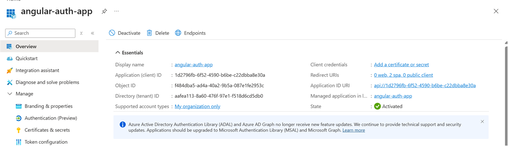
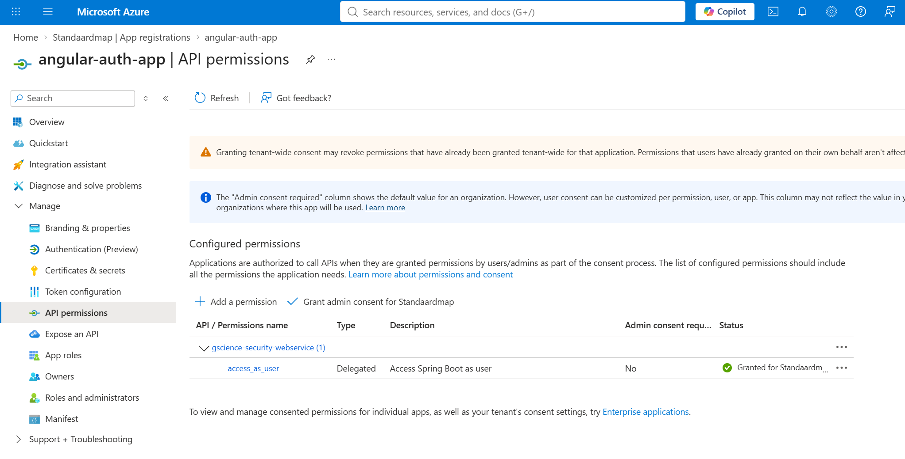
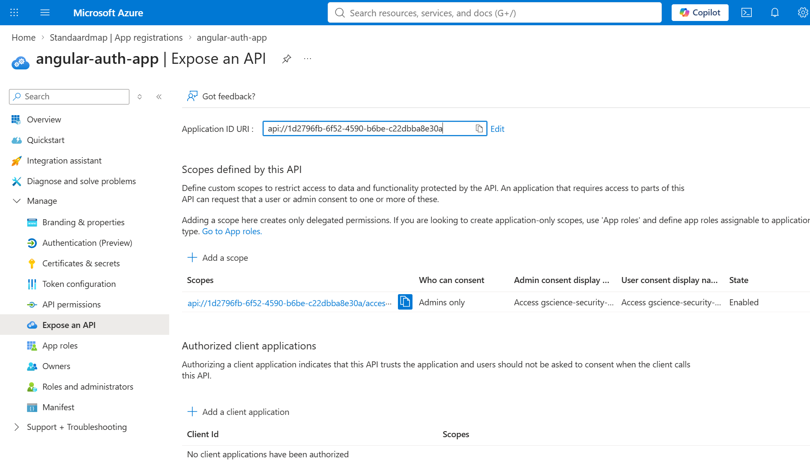

# Project for testing Azure entra-id


## Features
- implementing ajax spinner
- implementing

## OAuth 2.0 en OpenID Connect (OIDC). implementation

#### app.config.ts
```typescript
import {
  ApplicationConfig,
  provideBrowserGlobalErrorListeners,
  provideZoneChangeDetection
} from '@angular/core';
import { provideRouter } from '@angular/router';

import { routes } from './app.routes';
import {providePrimeNG} from 'primeng/config';
import {provideAnimationsAsync} from '@angular/platform-browser/animations/async';
import Aura from '@primeuix/themes/aura';

import {
  PublicClientApplication,
  InteractionType
} from '@azure/msal-browser';
import {
  MSAL_INSTANCE,
  MSAL_INTERCEPTOR_CONFIG,
  MsalService,
  MsalGuard,
  MsalBroadcastService, MsalModule, MsalInterceptor
} from '@azure/msal-angular';
import {HTTP_INTERCEPTORS, provideHttpClient, withInterceptors, withInterceptorsFromDi} from '@angular/common/http';
import {environment} from '../environments/environment';
import {ajaxBusyInterceptor} from '../interceptor/ajax-busy-interceptor'; // Pointing to the config file you created earlier

// 1. Initialize the MSAL Instance
export function MSALInstanceFactory(): PublicClientApplication {
  return new PublicClientApplication({
    auth: {
      clientId: environment.clientId,
      authority: environment.authority,
      redirectUri: environment.redirectUri
    }
  });
}

// 2. (Optional) Configure Guard to protect specific routes
export function MSALGuardConfigFactory() {
  return {
    interactionType: InteractionType.Redirect, // or InteractionType.Popup
    authRequest: {
      scopes: ['user.read'] // Add any default scopes your app needs on login
    }
  };
}

export const appConfig: ApplicationConfig = {
  providers: [
    provideHttpClient(
      withInterceptorsFromDi(),
      withInterceptors([ajaxBusyInterceptor]) // <--- 2. Registreer functionele interceptors hier
    ),
    {
      provide: HTTP_INTERCEPTORS,
      useClass: MsalInterceptor,
      multi: true
    },
    provideBrowserGlobalErrorListeners(),
    provideZoneChangeDetection({ eventCoalescing: true }),
    provideRouter(routes),
    provideAnimationsAsync(),
    providePrimeNG({
      theme: {
        preset: Aura,
        options: {
          darkModeSelector: '.my-app-dark' // optional
        }
      }
    }),
    // --- CRITICAL: Bind your MSAL instance factory here ---
    {
      provide: MSAL_INSTANCE,
      useFactory: MSALInstanceFactory
    },
    MsalService,
    MsalGuard,
    {
      provide: MSAL_INTERCEPTOR_CONFIG,
      useValue: {
        interactionType: InteractionType.Redirect,
        protectedResourceMap: new Map([
          [environment.apiUrl, [environment.scopes]]
        ])
      }
    },
    MsalBroadcastService
  ]
};
```

#### App
``` typescript
import {Component, OnInit, signal,OnDestroy} from '@angular/core';
import {Router, RouterOutlet} from '@angular/router';
import { MenubarModule } from 'primeng/menubar';
import { MenuItem } from 'primeng/api';
import {firstValueFrom, Subject} from 'rxjs';
import {MsalBroadcastService, MsalService} from '@azure/msal-angular';
import { EventMessage, EventType, InteractionStatus } from '@azure/msal-browser';
import { filter, takeUntil } from 'rxjs/operators';
import {ButtonModule} from 'primeng/button';
import {CommonModule} from '@angular/common';
import {environment} from '../environments/environment';
import {Spinner} from './components/spinner/spinner';

@Component({
  selector: 'app-root',
  imports: [RouterOutlet, MenubarModule,CommonModule, ButtonModule, Spinner],
  templateUrl: './app.html',
  styleUrl: './app.css'
})
export class App implements OnInit, OnDestroy {

  /** Titel van de applicatie */
  protected readonly title = signal('Angular Entra ID Auth');

  /** Items voor de PrimeNG menubar */
  items: MenuItem[] | undefined;

  /** Geeft aan of de gebruiker is ingelogd */
  loginDisplay = false;

  /** Subject om actieve subscriptions te stoppen bij vernietiging van de component (memory leak prevention) */
  private readonly _destroying$ = new Subject<void>();

  constructor(
    private authService: MsalService,
    private msalBroadcastService: MsalBroadcastService,
    private router: Router
  ) {}

  async ngOnInit() {

    // 1. CRUCIAAL: Vang de redirect/code op van Microsoft en ruim de URL op!
    this.authService.handleRedirectObservable()
      .pipe(takeUntil(this._destroying$))
      .subscribe({
        next: (result) => {
          if (result) {
            console.log('Login succesvol via redirect:', result);
            this.authService.instance.setActiveAccount(result.account);
          }
        },
        error: (error) => {
          console.error('Fout bij verwerken redirect:', error);
        }
      });

    // Eventueel URL opschonen als er nog query params (zoals ?state) in staan na redirect/logout
    if (window.location.search || window.location.hash.includes('state=')) {
      await this.router.navigate([], { replaceUrl: true });
    }

    //region Menu instellingen configureren
    this.items = [
      {
        label: 'profile',
        icon: 'pi pi-home',
        routerLink: ['/profile']
      },
      {
        label: 'API call',
        icon: 'pi pi-home',
        routerLink: ['/app-api-call-component']
      }
    ]
    //endregion

    //region Listen for successful login events
    try {
      await firstValueFrom(
        this.msalBroadcastService.msalSubject$.pipe(
          filter((msg: EventMessage) => msg.eventType === EventType.LOGIN_SUCCESS),
          takeUntil(this._destroying$)
        )
      );
      this.setLoginDisplay();
    } catch(e) {
      console.log(e)
    }

    this.msalBroadcastService.inProgress$
      .pipe(
        filter((status: InteractionStatus) => status === InteractionStatus.None),
        takeUntil(this._destroying$)
      )
      .subscribe(() => {
        this.setLoginDisplay();
      });
    //endregion
  }

  /**
   * Controleert of er actieve accounts bekend zijn en werkt de login-weergave bij.
   */
  setLoginDisplay() {
    this.loginDisplay = this.authService.instance.getAllAccounts().length > 0;
  }

  /**
   * Start het inlogproces via een MSAL redirect.
   */
  login() {
    // Triggers redirect login (or use loginPopup())
    this.authService.loginRedirect();
  }

  /**
   * Logt de gebruiker uit via een MSAL redirect.
   */
  logout() {
    this.authService.logoutRedirect({
      postLogoutRedirectUri: environment.redirectUri // Stuurt de gebruiker terug naar jouw frontend URL!
    });
  }

  /**
   * Ruimt alle actieve subscriptions op om geheugenlekken te voorkomen.
   */
  ngOnDestroy(): void {
    this._destroying$.next();
    this._destroying$.complete();
  }

}

```

#### app.html

``` typescript
<div class="card">
  <!-- PrimeNG Menubar -->
  <p-menubar [model]="items">
    <ng-template pTemplate="end">
      <div class="flex align-items-center gap-2">
        <!-- Toon Inloggen knop als de gebruiker NIET is ingelogd -->
        @if (!loginDisplay) {
          <p-button
            label="Inloggen"
            icon="pi pi-sign-in"
            severity="success"
            (click)="login()"
            (keydown.enter)="login()"
          >
          </p-button>
        }

        <!-- Toon Uitloggen knop als de gebruiker WEL is ingelogd -->
        @if (loginDisplay) {
          <p-button
            label="Uitloggen"
            icon="pi pi-sign-out"
            severity="danger"
            (click)="logout()"
            (keydown.enter)="logout()"
            >
          </p-button>
        }
      </div>
    </ng-template>
  </p-menubar>
</div>
<main class="content">
  <router-outlet />
  <app-spinner></app-spinner> <!-- the ajax spinner component -->
</main>

```

#### rest-api
``` typescript

```

#### Azure forms






## Ajax implementation
### Purpose
To show spinner with slow rest api call, to let the user now.
That the api has some startup or latensie problems

#### The interceptor implementation(ajax-busy-interceptor.ts)
``` typescript
import { inject } from '@angular/core';
import { HttpInterceptorFn } from '@angular/common/http';
import { finalize } from 'rxjs/operators';
import {AjaxBusyService} from '../services/ajax/ajax-busy-service';


export const ajaxBusyInterceptor: HttpInterceptorFn = (req, next) => {
  // Use inject() to get the service instance
  const busyService = inject(AjaxBusyService);

  busyService.beginRequest(); // Start the busy state logic

  // Handle the request and ensure endRequest is called on success/failure/cancellation
  return next(req).pipe(
    finalize(() => {
      busyService.endRequest(); // End the busy state logic
    })
  );
};
```

#### The spinner service implementation(spinner-service.ts)
``` typescript
import { Injectable } from '@angular/core';
import { BehaviorSubject, Observable} from 'rxjs';

@Injectable({
  providedIn: 'root'
})
export class SpinnerService {

   // Private Subject for emission (best practice)
  private readonly spinnerSubject = new BehaviorSubject<boolean>(false);

  // Public Observable for consumption
  public spinnerObservable: Observable<boolean> = this.spinnerSubject.asObservable();

  constructor() { }

  show(): void {
    console.log('SpinnerService: SETTING TRUE (Emitted)');
    this.spinnerSubject.next(true); 
  }

  hide(): void {
    console.log('SpinnerService: SETTING FALSE (Emitted)');
    this.spinnerSubject.next(false);
  }


}
```

#### ApplicationConfig(app.config.ts)
``` typescript
export const appConfig: ApplicationConfig = {
  providers: [
    provideHttpClient(
      withInterceptorsFromDi(),
      withInterceptors([ajaxBusyInterceptor]) // <--- insert the axaj interceptor
    ),
    {
      provide: HTTP_INTERCEPTORS,
      useClass: MsalInterceptor,
      multi: true
    },
    provideBrowserGlobalErrorListeners(),
    provideZoneChangeDetection({ eventCoalescing: true }),
    provideRouter(routes),
    provideAnimationsAsync(),
    providePrimeNG({
      theme: {
        preset: Aura,
        options: {
          darkModeSelector: '.my-app-dark' // optional
        }
      }
    }),
    // --- CRITICAL: Bind your MSAL instance factory here ---
    {
      provide: MSAL_INSTANCE,
      useFactory: MSALInstanceFactory
    },
    MsalService,
    MsalGuard,
    {
      provide: MSAL_INTERCEPTOR_CONFIG,
      useValue: {
        interactionType: InteractionType.Redirect,
        protectedResourceMap: new Map([
          [environment.apiUrl, [environment.scopes]]
        ])
      }
    },
    MsalBroadcastService
  ]
};

```
#### Declaration of the spinner(app.html)
``` html 

<main class="content">
  <router-outlet />
  <app-spinner></app-spinner> <!-- the ajax spinner component -->
</main>
```
